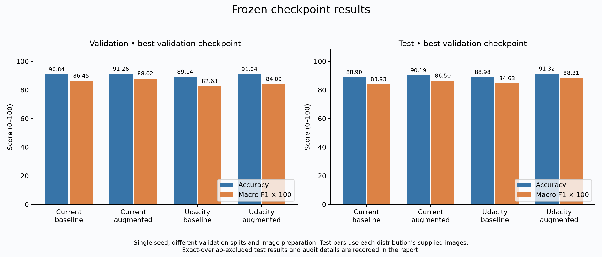
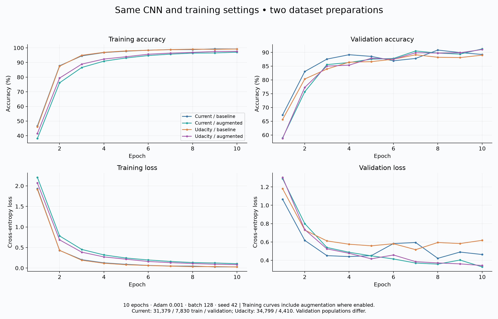
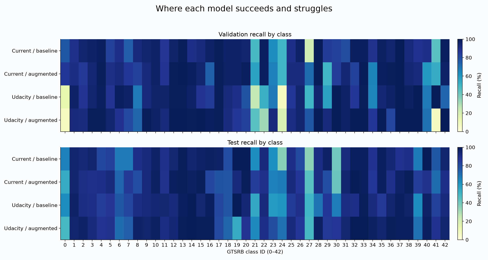
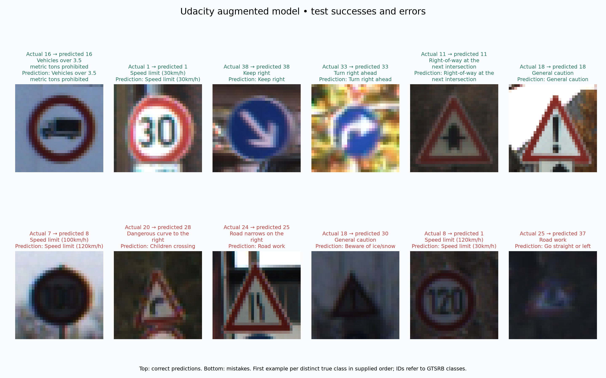

# Udacity dataset comparison

This experiment repeats the existing baseline and augmentation runs on the
locally supplied Udacity `train.p`, `valid.p`, and `test.p` files. Work is isolated
on `codex/udacity-comparison`; earlier checkpoints and results are preserved.

## Experimental controls

Both versions use the existing `BaselineCNN`, RGB 32 × 32 preprocessing with
values scaled to [0, 1], Adam at 0.001, batch size 128, seed 42, and ten epochs.
The augmentation variant uses the existing training-only affine transform.
Each run selects its checkpoint by validation accuracy; the first epoch wins
ties. Test evaluation happens only after both new training runs finish.

| Dataset preparation | Training images | Validation images | Test images |
|---|---:|---:|---:|
| Current GTSRB distribution | 31,379 | 7,830 | 12,630 |
| Udacity supplied arrays | 34,799 | 4,410 | 12,630 |

The training implementation is unchanged. A lossless adapter exports the
Udacity RGB arrays as PNGs, retaining their labels, order, and supplied split.
Schema-3 manifests explicitly identify a provided split. Schema-2 manifests
continue to enforce track separation. The supplied arrays do not include track
identifiers, so track independence is not claimed for the Udacity partition.
The generated ROI fields cover the full 32 × 32 image; they are placeholders
unused by this full-image pipeline, not reconstructed source bounding boxes.

## Interpretation

This compares two preparations of GTSRB with the same pipeline. It does not
isolate a causal dataset effect: training sizes, validation membership, order,
and upstream resizing differ. Udacity images arrive at 32 × 32; current images
are resized from their original dimensions. The test sets have the same number
of images, but pixel equality and cross-distribution pairing are not assumed.
These are single-seed results, without uncertainty estimates across runs.

No exact RGB duplicate groups were found between Udacity training and validation.
Test evaluation audits overlap with the combined training/validation source and
reports both full supplied-set and exact-overlap-excluded metrics. Near-duplicate
independence is unverified. Test results are descriptive, not tuning criteria.

## Reproduction

Run from the project root with the existing environment. The converter accepts
trusted pickle files only. Each preparation, training, and evaluation destination
must be new; prior outputs are protected from overwriting.

```powershell
uv run python scripts/prepare_udacity.py
uv run python scripts/run_udacity_comparison.py
uv run python scripts/plot_dataset_comparison.py
```

The second command trains both Udacity variants and evaluates all four frozen
checkpoints using the existing evaluation pipeline. It requires the original
baseline and augmentation checkpoints and their original split manifest.
Individual training runs can also use the standard CLI:

```powershell
uv run traffic-sign-classifier train --config configs/udacity-baseline.toml
uv run traffic-sign-classifier train --config configs/udacity-augmentation.toml
```

Local arrays, converted images, manifests, checkpoints, and detailed reports stay
in ignored `data/` and `outputs/`. Figures and compact metrics are retained under
`docs/figures/udacity-comparison/`. Source pickle SHA-256 fingerprints and conversion
audit details are saved in `data/udacity/provenance.json` and `split.json`.

To evaluate already completed runs without retraining, use
`uv run python scripts/run_udacity_comparison.py --evaluate-only --output-root outputs/comparison-repeat`.
Point the plot script at those reports with `--reports outputs/comparison-repeat`.
This checks that all configured epochs completed
before evaluating any test set. Training cannot resume from inference-only
checkpoints; interrupted attempts are kept separately and restarted from seed 42.

## Completed results — 2026-10-05

| Preparation / experiment | Best epoch | Validation accuracy | Validation macro F1 | Test accuracy | Test macro F1 |
|---|---:|---:|---:|---:|---:|
| Current / baseline | 8 | 90.84% | 0.8645 | 88.90% | 0.8393 |
| Current / augmented | 10 | 91.26% | 0.8802 | 90.19% | 0.8650 |
| Udacity / baseline | 7 | 89.14% | 0.8263 | 88.98% | 0.8463 |
| Udacity / augmented | 10 | 91.04% | 0.8409 | 91.32% | 0.8831 |

On the supplied Udacity partition, augmentation improves validation accuracy by
1.90 percentage points and test accuracy by 2.34 points. Compared with the current
augmented run, Udacity's augmented result is 0.22 points lower on validation and
1.13 points higher on its supplied test images. These are descriptive differences
between preparations, not evidence that one dataset or split is universally better.
Neither preparation reaches the course's 93% validation target in these runs.

Macro F1 exposes weaknesses hidden by overall accuracy. The Udacity augmented
validation model has recall of 2/30 (6.7%) on class 0 (20 km/h speed limit) and
class 41 (end of no passing), and 6/30 (20%) on class 24 (road narrows on the right).
Its validation macro F1 is lower than the current augmented run despite very
similar overall accuracy. These small class supports limit interpretation.

Both current-distribution test evaluations contain eight exact matches to the
training/validation source. Excluding those images leaves 12,622 examples and
88.89% baseline / 90.18% augmented accuracy. Both Udacity test audits found zero
exact overlaps; their full-set metrics remain unchanged on all 12,630 images.
This does not establish near-duplicate or track independence.

## Figures









The example grid uses the first correctly and incorrectly classified image per
distinct true class in supplied test order (six each). It is illustrative, not a
random or representative estimate of performance. Macro F1 is multiplied by 100
only in the score chart so both measures share a 0–100 plotting scale.

## Validation and artifacts

- 118 existing/manifest tests passed, plus the new lossless-conversion test (119 total).
- Ruff lint and formatting checks passed; mypy passed for all 16 source files.
- Both new runs completed all ten epochs on the same RTX 3060 GPU and dependency
  versions as the current runs; all eight frozen-checkpoint evaluations completed.
- All four figures were visually inspected; the prediction-grid spacing was adjusted.
- Exact metrics: [summary.json](figures/udacity-comparison/summary.json).
- Source fingerprints: [dataset-provenance.json](figures/udacity-comparison/dataset-provenance.json).
- Detailed evaluation JSON, predictions, and confusion matrices: `outputs/comparison/`.
- New checkpoints: `outputs/runs/udacity-baseline-v1/best.pt` and
  `outputs/runs/udacity-augmentation-v1/best.pt`.

Initial execution attempts encountered slow startup and an interrupted diagnostic
run. Their partial outputs were preserved with `-interrupted` suffixes. Only the
complete runs at the paths above contribute to the figures and reported metrics.
